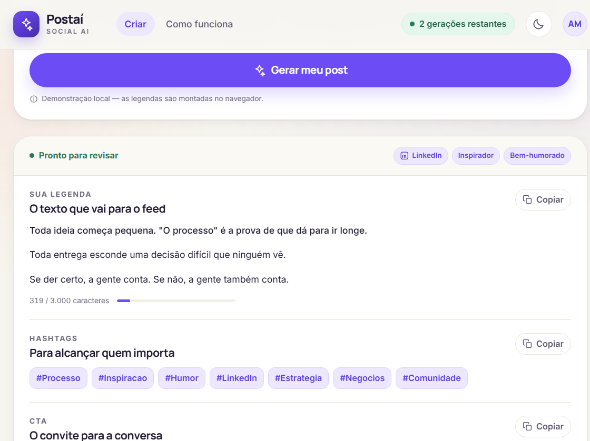
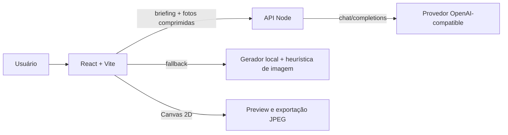
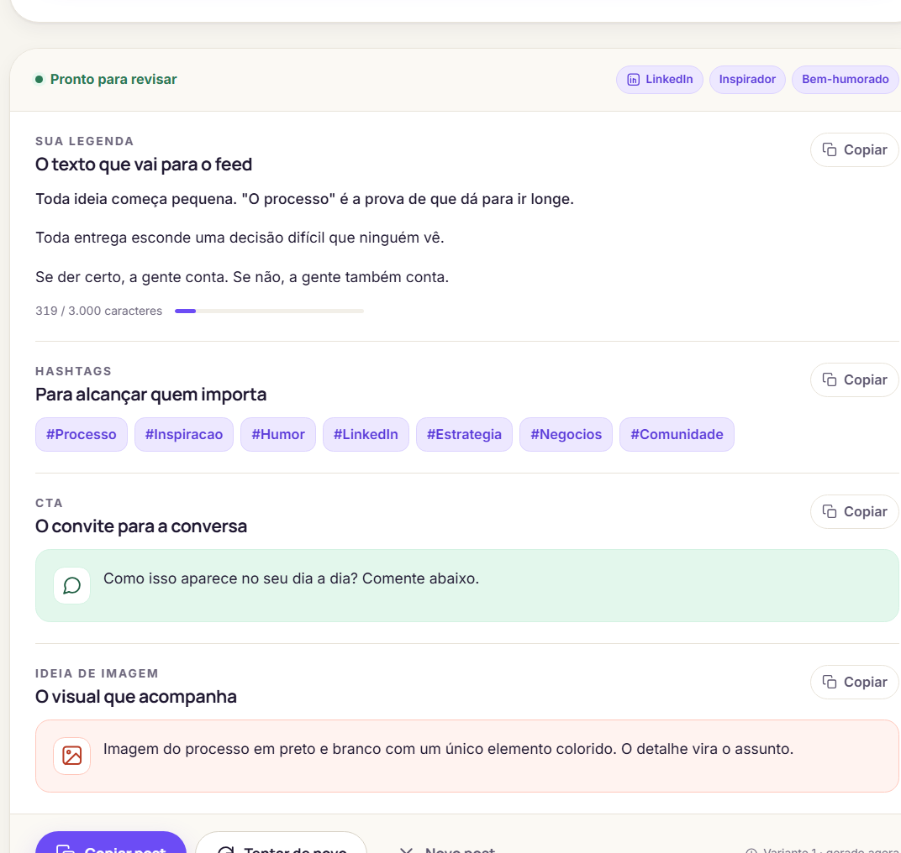

<div align="center">

# Postaí

**Da ideia ao post pronto — com IA real, fallback local e edição visual no navegador.**

Gerador de posts para **Instagram, TikTok e LinkedIn** que transforma um briefing curto em legenda, hashtags, CTA, ideia de imagem e arte editável.

[](#stack)
[](#stack)
[](#stack)
[](#stack)
[](#stack)
[](#arquitetura)
[](#qualidade-e-validação)

**Navegue por:** [Visão geral](#visão-geral) · [Funcionalidades](#funcionalidades) · [Arquitetura](#arquitetura) · [Como rodar](#como-rodar) · [API](#api) · [Decisões](#decisões-de-engenharia)

</div>

<p align="center">
  
</p>

<p align="center">
  <sub>Interface principal: abertura editorial e início do briefing.</sub>
</p>

---

## Visão geral

Criar conteúdo para redes sociais exige mais do que escrever um bom texto: é preciso adaptar o gancho à plataforma, escolher o tom certo, montar um CTA, sugerir uma imagem e garantir que a arte final combine com a marca.

O **Postaí** cobre esse fluxo de ponta a ponta. O usuário descreve a ideia, escolhe plataforma, tom e público, e recebe um post estruturado. Se enviar fotos, o app também analisa o conjunto, escolhe um tratamento visual, sugere texto sobre a imagem e permite exportar a arte em JPEG.

O projeto foi construído como um **estudo de produto full-stack**, com foco em três pontos:

- **IA aplicada de verdade**, e não apenas um prompt solto no frontend.
- **Segurança da chave e dos dados**, com integração server-side.
- **Experiência resiliente**, que continua funcionando sem IA, sem rede ou sem chave configurada.

| | |
| --- | --- |
| **Problema** | Transformar um briefing curto em um post pronto, sem perder tempo com estrutura, tom, hashtags e visual. |
| **Solução** | App full-stack que gera texto, analisa fotos e permite editar/exportar a arte no navegador. |
| **Destaques técnicos** | IA server-side, fallback local determinístico, Canvas 2D, validação de respostas, acessibilidade e design system próprio. |
| **Stack principal** | React 18, TypeScript 5, Vite 5, Node 20+, API compatível com OpenAI. |
| **Status** | Funcional, com build de produção, documentação e fluxo de IA validado. |

> **Destaque de engenharia:** a IA é opcional por design. Sem `AI_API_KEY`, o app funciona 100% no navegador com o gerador local. Se o provedor falhar, demorar demais ou devolver um JSON inválido, o fallback entra automaticamente.

---

## O que este projeto demonstra

### Frontend de produto
- Estado assíncrono com loading, erro, cancelamento e retry.
- Componentização clara e contratos TypeScript compartilhados.
- Design system com tokens, temas claro/escuro e tipografia editorial.
- Fluxo completo de upload, preview, edição e exportação de imagens.

### Backend seguro
- API Node que atua como proxy para o provedor de IA.
- Chave de API somente no servidor, nunca no bundle do navegador.
- Validação e normalização das respostas do modelo antes de devolver ao frontend.
- Limite de payload, timeout e tratamento de erros do provedor.

### IA aplicada
- Prompts estruturados para geração de texto e análise de visão.
- Respostas em JSON com parsing tolerante a blocos de código.
- Visão computacional com até 3 fotos comprimidas por análise.
- Fallback local quando a IA não está disponível.

### Canvas e imagem
- Filtros com intensidade ajustável.
- Color matching entre fotos do mesmo post.
- Texto sobre a imagem com contraste calculado e posição configurável.
- Exportação em 4:5, 1:1 e 9:16.

### UX e acessibilidade
- Navegação por teclado e foco visível.
- `aria-live` para estados de geração e avisos.
- Mensagens de erro com `role="alert"`.
- Respeito a `prefers-reduced-motion` e contraste conferido nos dois temas.

---

## Funcionalidades

### Geração de conteúdo
- **Briefing guiado**: tema, plataforma, até 2 tons de voz e público.
- **Legenda, hashtags, CTA e ideia de imagem** em cartões separados.
- **Tom de voz**: Autêntico, Inspirador, Bem-humorado, Educativo e Direto.
- **Público**: Seguidores, Clientes e leads, Comunidade e Recrutadores.
- **Variações**: *Tentar de novo* gera outra versão sem consumir cota.
- **Cópia rápida** de cada bloco com feedback visual.

### Fotos e estúdio
- Até **6 fotos** por post, com a primeira funcionando como capa.
- Filtros **Papel, Fresco, Criativo, Humano e Tinta**, com intensidade ajustável.
- **Color matching** para harmonizar as fotos com a capa.
- Texto sobre a imagem editável, com posição e alinhamento.
- Fontes **Manrope, Lora, Inter, Playfair e Space Grotesk**.
- Exportação individual, em lote ou compartilhamento quando o navegador suportar.

### Produto e experiência
- Tema claro/escuro aplicado antes do primeiro paint.
- Briefing e último post restaurados via `localStorage`.
- Cota de demonstração de 3 gerações por dia.
- Layout responsivo e estados vazios/loading/erro bem definidos.

---

## Stack

| Camada | Tecnologias |
| --- | --- |
| **Frontend** | React 18, TypeScript 5, Vite 5, CSS puro com design tokens |
| **Backend** | Node 20+, API server-side, middleware de desenvolvimento no Vite, servidor de produção próprio |
| **IA** | API compatível com OpenAI Chat Completions, texto + visão, prompts estruturados e validação de JSON |
| **Imagens** | Canvas 2D, filtros, color matching, compressão JPEG e exportação |
| **Qualidade** | Build de produção, checagem de tipos, acessibilidade, fallback e validação manual dos fluxos |

---

## Arquitetura



**Fluxo resumido:**

1. O usuário preenche o briefing e, opcionalmente, envia fotos.
2. O frontend consulta `/api/health` para saber se a IA real está disponível.
3. Com IA habilitada, o servidor chama o provedor e devolve conteúdo validado.
4. Sem IA ou em caso de falha, o gerador local e a heurística de imagem assumem.
5. O resultado é editável no estúdio e exportado via Canvas.

> A chave `AI_API_KEY` fica apenas no servidor. O navegador nunca recebe a credencial.

<p align="center">
  
</p>

<p align="center">
  <sub>Resultado gerado com legenda, hashtags, CTA e sugestão visual.</sub>
</p>

---

## Como rodar

### Pré-requisitos

- **Node.js 20+**
- **npm**

### Instalação

```bash
npm install
npm run dev
```

O Vite abre em `http://localhost:5173`. O middleware de desenvolvimento já expõe as rotas `/api/*`.

> No Windows com PowerShell bloqueando `npm.ps1`, use `npm.cmd install`, `npm.cmd run dev`, etc.

### Modo local (sem chave)

O app funciona sem nenhuma configuração adicional:

- geração de texto pelo motor local;
- análise de fotos pela heurística local;
- filtros, fontes, preview e exportação normalmente.

### Modo IA real

1. Copie `.env.example` para `.env`.
2. Preencha `AI_API_KEY`.
3. Reinicie o `npm run dev`.

```env
AI_API_KEY=sua-chave
AI_BASE_URL=https://api.openai.com/v1
AI_TEXT_MODEL=gpt-4o-mini
AI_VISION_MODEL=gpt-4o-mini
AI_TIMEOUT_MS=60000
```

`AI_BASE_URL` aceita qualquer endpoint compatível com `POST /chat/completions` — OpenAI, OpenRouter, Groq, provedores locais etc. Se o modelo escolhido não suportar visão, a análise de fotos cai automaticamente para a heurística local.

### Produção

```bash
npm run build
npm start
```

O servidor de produção serve o `dist` e as rotas `/api` na mesma origem. A porta padrão é `4173` e pode ser alterada com `PORT`.

---

## Scripts

| Comando | O que faz |
| --- | --- |
| `npm run dev` | Inicia o Vite com o middleware de `/api`. |
| `npm run build` | Executa a checagem de tipos e gera o build de produção. |
| `npm run preview` | Sobe o servidor de produção (`dist` + `/api`). |
| `npm start` | Equivalente ao `preview`, usando `PORT` (padrão `4173`). |
| `npm run typecheck` | Executa apenas a checagem de tipos. |

---

## API

A integração é **server-side**. O navegador chama apenas `/api/*`.

| Método | Rota | Corpo | Resposta |
| --- | --- | --- | --- |
| `GET` | `/api/health` | — | `{ enabled, provider, textModel, visionModel }` |
| `POST` | `/api/generate-post` | `{ brief, variant }` | `{ source: "ai", content: { caption, hashtags, cta, imageIdea, imageText } }` |
| `POST` | `/api/analyze-photos` | `{ brief, photos: [{ dataUrl, stats, name }] }` | `{ source: "ai", analysis: { presetId, font, anchor, align, reason } }` |

- `POST /api/generate-post` usa `AI_TEXT_MODEL` e devolve o conteúdo já validado/normalizado.
- `POST /api/analyze-photos` usa `AI_VISION_MODEL` e envia no máximo **3 fotos comprimidas** para o provedor.
- O limite de corpo é **12 MB**; o timeout padrão é **60 s** (`AI_TIMEOUT_MS`).
- Erros de configuração retornam `503 AI_NOT_CONFIGURED`; falhas do provedor retornam `502`; timeout retorna `504`.

### Variáveis de ambiente

| Variável | Obrigatória | Descrição |
| --- | --- | --- |
| `AI_API_KEY` | Não | Ativa a IA real. Sem ela, o app usa o fallback local. |
| `AI_BASE_URL` | Não | Base URL do provedor compatível com OpenAI. |
| `AI_TEXT_MODEL` | Não | Modelo de texto. Padrão: `gpt-4o-mini`. |
| `AI_VISION_MODEL` | Não | Modelo de visão. Padrão: `gpt-4o-mini`. |
| `AI_TIMEOUT_MS` | Não | Timeout das chamadas ao provedor. Padrão: `60000`. |
| `PORT` | Não | Porta do servidor de produção. Padrão: `4173`. |

---

## Decisões de engenharia

### 1. IA no servidor, não no cliente
A chave do provedor nunca entra no bundle. O frontend conversa apenas com a API interna, que valida a entrada, chama o provedor e normaliza a resposta.

### 2. Fallback como requisito, não como exceção
O app não depende da IA para funcionar. Se não houver chave, o gerador local assume. Se o provedor falhar, demorar demais ou devolver JSON inválido, o fallback entra automaticamente. Isso mantém a demonstração utilizável em qualquer ambiente.

### 3. Contratos normalizados
O frontend não confia cegamente no que o modelo devolve. O servidor valida e normaliza legenda, hashtags, CTA, ideia de imagem, fonte, filtro, posição e alinhamento antes de responder.

### 4. Visão com custo controlado
A análise de fotos envia no máximo 3 imagens comprimidas em JPEG de 640 px. O corpo da requisição tem limite de 12 MB e as chamadas têm timeout configurável.

### 5. Ajustes manuais vencem
Se o usuário trocar filtro, fonte, posição ou alinhamento enquanto a IA ainda está respondendo, a escolha manual é preservada. O app também deixa explícito se a decisão veio da IA real, da heurística local ou do usuário.

### 6. Privacidade por padrão
Sem IA real, nenhum texto ou foto sai do navegador. Com IA real, apenas o briefing e até 3 JPEGs reduzidos são enviados ao provedor para a análise. Nenhum blob de imagem é salvo em `localStorage`.

### 7. Acessibilidade e design system
O projeto usa tokens de design em vez de cores soltas, suporta tema claro/escuro, foco visível, navegação por teclado, `aria-live` e `prefers-reduced-motion`.

---

## Segurança e privacidade

- `AI_API_KEY` é lida somente no servidor (`server/api.mjs`).
- O `.env` está no `.gitignore` e não é versionado.
- O navegador nunca recebe a chave do provedor.
- Sem IA real, nenhum texto ou foto sai do navegador.
- Com IA real, o briefing e até 3 JPEGs reduzidos (640 px) são enviados ao provedor apenas para gerar a resposta.
- As fotos continuam apenas na sessão do navegador; nenhum blob é salvo em `localStorage`.
- O servidor de produção serve `dist` e `/api` na mesma origem.
- A cota de 3 gerações é client-side e **não substitui rate limiting**. Para expor o app publicamente, adicione autenticação e limite de requisições no servidor ou em um proxy.

---

## Qualidade e validação

- `npm run build` — checagem de tipos + build de produção.
- `npm run typecheck` — checagem de tipos isolada.
- Fluxo sem chave validado: health check desabilitado, geração local e análise local de fotos.
- Fluxo completo de IA validado com um provedor **OpenAI-compatible de teste**:
  - geração de post com conteúdo retornado pela IA;
  - análise de foto com filtro, fonte, posição e alinhamento;
  - badges e toasts indicando a origem da resposta.
- Servidor de produção validado em `http://127.0.0.1:4173` com `/api/health` e `/` retornando `200`.

> A integração com um provedor real depende de uma `AI_API_KEY`. O caminho completo foi validado com um provedor fake compatível; a troca para um provedor real é apenas configuração.

**Limitação atual:** o projeto ainda não possui suíte de testes automatizados. A validação é feita por build, typecheck e testes manuais dos fluxos principais. A inclusão de Vitest/Playwright está nos próximos passos.

---

## Estrutura do projeto

<details>
<summary><strong>Ver árvore de arquivos</strong></summary>

```text
server/
├─ api.mjs                 # rotas /api, prompts, validação e chamadas ao provedor
├─ api.d.mts               # tipos usados pelo vite.config.ts
└─ index.mjs               # servidor de produção (dist + /api)

src/
├─ App.tsx                 # estado, fluxo de geração e composição da página
├─ main.tsx                # bootstrap do React
├─ types.ts                # contratos compartilhados
├─ components/
│  ├─ Header.tsx           # marca, navegação, cota e tema
│  ├─ Hero.tsx             # abertura editorial
│  ├─ HowItWorks.tsx       # briefing → adaptação → publicação
│  ├─ Composer.tsx         # formulário, validação, exemplos e upload
│  ├─ PhotoUploader.tsx    # upload, capa e remoção de fotos
│  ├─ PhotoStudio.tsx      # filtro, fonte, texto, formato, exportação e share
│  ├─ PlatformPicker.tsx   # seleção de plataforma
│  ├─ TonePicker.tsx       # seleção de até 2 tons
│  ├─ ResultPanel.tsx      # estados vazio/loading/erro/pronto + cópia
│  ├─ Toast.tsx            # avisos de cópia, cota e exportação
│  └─ Icon.tsx             # ícones SVG inline
├─ data/                   # plataformas, tons, públicos, exemplos, filtros, fontes e formatos
├─ lib/
│  ├─ ai.ts                # health check, chamadas /api e normalização das respostas
│  ├─ generator.ts         # motor local (ganchos, corpos, CTAs, hashtags e texto da foto)
│  ├─ image.ts             # normalização, filtros, color matching, canvas e exportação
│  ├─ storage.ts           # tema, briefing, último post e cota
│  └─ clipboard.ts         # clipboard API + fallback
└─ styles/
   ├─ tokens.css           # cores, tipografia, espaço, sombras, temas
   ├─ base.css             # reset, botões e utilidades
   └─ app.css              # layout e componentes
```

</details>

---

## Design system

<details>
<summary><strong>Ver tokens, tipografia e regras visuais</strong></summary>

O visual segue o **Postaí Style Guide v1.0**. Os tokens ficam em `src/styles/tokens.css` e nenhum componente usa hex solto.

| Papel | Cor |
| --- | --- |
| Criativo (primária) | `#6C4CF5` |
| Humano (secundária) | `#FF8068` |
| Fresco (acento) | `#C9EEDB` |
| Tinta (texto) | `#201932` |
| Papel (fundo) | `#F7F5EF` |
| Superfície lilás | `#EDE8FF` |

**Tipografia:**

- **Manrope** — títulos, botões e rótulos (display).
- **Lora itálico** — destaque editorial (ex.: *conversa* no hero).
- **Inter** — corpo de texto e interface.

A regra de proporção do guia — **60% base · 25% texto · 10% marca · 5% acento** — orienta a composição. Há suporte completo a tema escuro.

</details>

---

## Acessibilidade

- Navegação por teclado com foco visível.
- `aria-live` nos estados de geração e nos avisos.
- Rótulos associados aos campos e mensagens de erro com `role="alert"`.
- Contraste conferido nos dois temas.
- Respeito a `prefers-reduced-motion`.

---

## Próximos passos

- Adicionar testes automatizados com **Vitest** e **Playwright**.
- Implementar rate limiting e autenticação para uma exposição pública.
- Adicionar observabilidade e logs estruturados no servidor.
- Explorar streaming de resposta e suporte a mais provedores.
- Evoluir o histórico de posts e a biblioteca de imagens.

---

## Autor

Projeto de portfólio desenvolvido por **Filipe**, com foco em frontend de produto, integração segura de IA e experiência do usuário.

> Quer trocar uma ideia sobre o projeto? Abra uma issue neste repositório.
